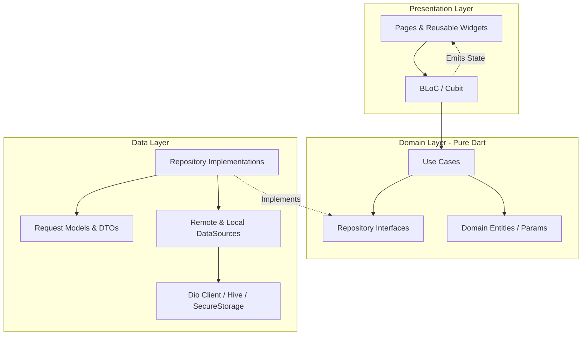

# Flutter Clean Architecture & BLoC Starter Boilerplate

A production-ready Flutter starter boilerplate built with **Feature-First Clean Architecture**, **BLoC / Cubit** state management, **GetIt** dependency injection, and modern mobile engineering best practices.

Designed to serve as a solid, scalable foundation for new production Flutter projects targeting iOS and Android.

---

## Table of Contents

- [Core Features & Included Modules](#core-features--included-modules)
- [Architecture Overview](#architecture-overview)
- [Project Structure](#project-structure)
- [Prerequisites & SDK Version](#prerequisites--sdk-version)
- [Quick Start](#quick-start)
- [Environments & Native Flavors](#environments--native-flavors)
- [How to Bootstrap a New Project](#how-to-bootstrap-a-new-project)
- [Feature Implementation Guide](#feature-implementation-guide)
- [Engineering Guidelines & Rules](#engineering-guidelines--rules)
- [Useful Commands](#useful-commands)

---

## Core Features & Included Modules

| Module / Layer | Included Capabilities |
| --- | --- |
| **Authentication & Session** | Complete flow: Splash, Intro walkthrough, Sign In, Sign Up, Email/Code Verification, Forgot Password, and persistent Session Restoration. |
| **Onboarding & Tutorials** | Onboarding flow, interactive tutorial slides, and account completion step. |
| **Account & Profile** | User profile viewing, account editing, document uploads, and secure password updates. |
| **App Settings & Legal** | Permission settings, Device settings integration, Contact Us form, and generic Legal Content views (Terms & Conditions, Privacy Policy, About Us). |
| **Notifications** | Push notification integration (Firebase Messaging), local notifications handler, and in-app Notification list/detail screens. |
| **Network & API** | Resilient Dio client with interceptors (logging, auth tokens, session expiration), internet connectivity monitoring, and `safeApiCall` / `Result<T>` error handling. |
| **Local Storage** | Encrypted key-value persistence (`flutter_secure_storage`) and fast NoSQL cache (`hive_flutter`). |
| **Design System & Theming** | Strict design tokens (`AppSpacing`, `Gap`, `AppRadius`, `AppColors`), typography extensions (`context.headlineX()`, `context.bodyX()`), and reusable UI facade widgets. |
| **Declarative Navigation** | Type-safe URL routing powered by `go_router` with state restoration and deep-link readiness. |
| **Multi-Environment Setup** | Independent configuration for Development, Staging, and Production with `.env` files and native Android/iOS flavors (`sandbox`, `live`). |
| **Localization (l10n)** | Type-safe internationalization configured via Flutter ARB files (`intl`, `flutter_localizations`). |

---

## Architecture Overview

This boilerplate adheres to **Feature-First Clean Architecture**. Code is grouped by domain feature rather than technical layer, strictly following inward dependency rules:



### Architectural Principles

1. **Domain Purity**: All objects in `domain/` (`entities/`, `usecases/`, `repositories/`) are pure Dart (extending `Equatable`). They **never** contain JSON serialization (`toJson`, `fromJson`) or API transport concerns.
2. **Dedicated Request Models**: Every payload or query filter sent to an API uses a dedicated Data Layer model (e.g., `*RequestModel`) with a `RequestModel.fromEntity(params)` translation factory.
3. **Strict Error Handling**: Data sources use `safeApiCall`, repositories wrap calls with `safeRepositoryCall`, and use cases return `Future<Result<T>>` containing either a successful value or a typed `Failure`.
4. **No UI Hardcoding**: No hardcoded colors, font styles, sizes, or spacings in widget code. All UI elements consume theme extensions and tokens (`AppSpacing`, `Gap`, `AppRadius`, `context.colorScheme`).

---

## Project Structure

```text
lib/
├── app/                  # Application root, theme configurations, router, and shell
│   ├── controller/       # GoRouter configuration, AppCubit, RouterNotifier
│   ├── theme/            # Design tokens, typography scales, theme extensions
│   └── view/             # App widget, ShellController, SplashPage
├── core/                 # Cross-feature infrastructure & shared domain
│   ├── auth_core/        # Global authentication credentials & token management
│   ├── connectivity/     # Internet connection monitoring
│   ├── di/               # Global service locator registration (get_it)
│   ├── error/            # Failures (failures.dart) and Exceptions (exceptions.dart)
│   ├── network/          # Dio client, safeApiCall, and interceptors
│   ├── notifications/    # Push notifications setup and handlers
│   ├── storage/          # SecureStorage and Hive local caching
│   ├── usecases/         # Base use case contracts, Result<T>, safeRepositoryCall
│   └── user/             # Global user entity and core profile session
├── features/             # Feature-first modular business domains
│   ├── auth/             # Login, signup, password reset, code verification
│   ├── more/             # Settings, contact us, legal terms & policies
│   ├── notifications/    # Notification feed and details
│   ├── onboarding/       # Intro walkthrough, tutorials, account completion
│   └── profile/          # Profile details, document management, change password
├── utils/                # UI facade widgets, helpers, formatters, and constants
│   ├── constants/        # AppSpacing, Gap, AppRadius, AppColors, AppImages
│   ├── extensions/       # Context, text style, date, and string extensions
│   ├── formatters/       # Currency, phone, date input/output formatters
│   └── widgets/          # CommonAppBar, CommonButton, CommonImage, form_fields/
├── l10n/                 # Localization ARB source files and generated Dart
├── bootstrap.dart        # Async app initialization and service bootstrap
└── main_development.dart # Flavor-specific entry points (dev, staging, prod)
```

---

## Prerequisites & SDK Version

- **Flutter SDK**: `>= 3.2.6 < 4.0.0` (Recommended: **3.47.5**, pinned in [.fvmrc](.fvmrc))
- **Dart SDK**: Compatible with Flutter SDK
- **iOS Tooling**: macOS with Xcode 15+ and CocoaPods
- **Android Tooling**: Android Studio with Android SDK API 34+

---

## Quick Start

### 1. Setup Environment Configuration

Copy the example environment template to create your local development environment:

```sh
cp env/.env.example env/.env.development
```

Update `env/.env.development` with your backend API base URL and required third-party service keys.

### 2. Install Dependencies & Verify

```sh
flutter pub get
dart analyze
```

### 3. Run the Application

Launch the development flavor on your simulator or connected device:

```sh
# Android / iOS Development
flutter run --flavor sandbox -t lib/main_development.dart
```

---

## Environments & Native Flavors

The project supports three distinct runtime environments mapped to native build flavors:

| Environment | Dart Entry Point | Native Flavor (Android / iOS) | Environment File |
| --- | --- | --- | --- |
| **Development** | `lib/main_development.dart` | `sandbox` | `env/.env.development` |
| **Staging** | `lib/main_staging.dart` | `sandbox` | `env/.env.staging` |
| **Production** | `lib/main_production.dart` | `live` | `env/.env.production` |

> **Note**: Staging and Production `.env` files should be created from `env/.env.example` and kept out of version control.

---

## How to Bootstrap a New Project

When using this repository as a boilerplate for a new project, follow these initial setup steps:

### 1. Rename App Package & Bundle ID
- **Android**: Update `applicationId` and `namespace` in [android/app/build.gradle](android/app/build.gradle).
- **iOS**: Update `PRODUCT_BUNDLE_IDENTIFIER` in [ios/Runner.xcodeproj](ios/Runner.xcodeproj/project.pbxproj).
- *Tip*: You can use the `change_app_package_name` package or update them manually.

### 2. Update Application Name & Assets
- Update `name` and `description` in [pubspec.yaml](pubspec.yaml).
- Change app launcher names in:
  - Android: `android:label` in [android/app/src/main/AndroidManifest.xml](android/app/src/main/AndroidManifest.xml).
  - iOS: `CFBundleDisplayName` in [ios/Runner/Info.plist](ios/Runner/Info.plist).
- Replace application logo assets in `assets/images/` and app icons.

### 3. Setup Firebase
- Create a new project in the [Firebase Console](https://console.firebase.google.com/).
- Place native configuration files:
  - Android: `android/app/src/sandbox/google-services.json` and `android/app/src/live/google-services.json`.
  - iOS: Firebase configurations according to target schemes in `ios/Firebase/`.

### 4. Configure Theme & Branding
- Adjust brand colors in `lib/app/theme/` and `lib/utils/constants/colors.dart`.
- Define typography scale in `lib/app/theme/app_typography.dart`.

---

## Feature Implementation Guide

When adding a new feature (e.g. `features/orders`):

### 1. Structure the Feature Directory
```text
lib/features/orders/
├── data/
│   ├── datasources/        # orders_remote_data_source.dart
│   ├── models/             # order_model.dart, create_order_request_model.dart
│   └── repositories/       # orders_repository_impl.dart
├── domain/
│   ├── entities/           # order.dart, create_order_params.dart
│   ├── repositories/       # i_orders_repository.dart
│   └── usecases/           # get_orders_use_case.dart, create_order_use_case.dart
├── presentation/
│   ├── bloc/               # orders_cubit.dart, orders_state.dart
│   ├── pages/              # orders_page.dart, order_details_page.dart
│   └── widgets/            # order_card.dart (one widget per file)
├── orders_injection.dart   # Feature dependency injection
└── orders.dart             # Barrel export
```

### 2. Implement Layers
1. **Domain**: Define pure entities (`Order`) and use case parameters (`CreateOrderParams`). Define repository contract (`IOrdersRepository`).
2. **Data**: Implement `OrdersRemoteDataSource` using `safeApiCall`. Implement `OrdersRepositoryImpl` using `safeRepositoryCall` to map params to `*RequestModel` and response models to domain entities.
3. **Presentation**: Build state management (`OrdersCubit`) and extract reusable UI components (`OrderCard`).
4. **Dependency Injection**: Register all layers in `orders_injection.dart` and call it inside `lib/core/di/injection_container.dart`.
5. **Routing**: Add the feature's routes to `Pages` enum (`lib/utils/pages.dart`) and register them in `lib/app/controller/router.dart`.

---

## Engineering Guidelines & Rules

- **Zero Hardcoding**:
  - Always use `context.headlineX()` / `context.bodyX()` — avoid inline `TextStyle` or raw `GoogleFonts`.
  - Always use `Gap.x` or `AppSpacing.x` — avoid raw `SizedBox(height: 16)`.
  - Always use `context.colorScheme` — avoid raw `Colors.red` or hardcoded hex colors.
- **Widget Extraction**:
  - Break complex screens into atomic `StatelessWidget` classes inside `presentation/widgets/`.
  - Never use private helper methods like `Widget _buildRow()`.
- **Pre-Commit Zero Warnings Policy**:
  - The project must always pass `dart analyze` with **0 errors and 0 warnings**.

---

## Useful Commands

```sh
# Fetch packages
flutter pub get

# Run static analysis
dart analyze

# Run code generator (build_runner)
dart run build_runner build --delete-conflicting-outputs

# Watch code generator during development
dart run build_runner watch --delete-conflicting-outputs

# Generate localization files
flutter gen-l10n

# Clean build cache
flutter clean && flutter pub get
```
